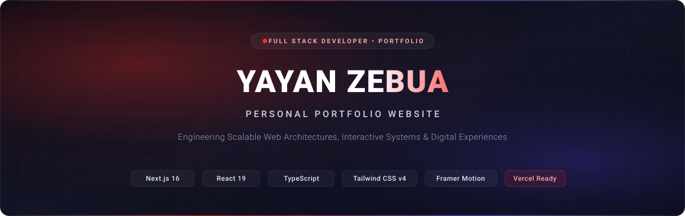
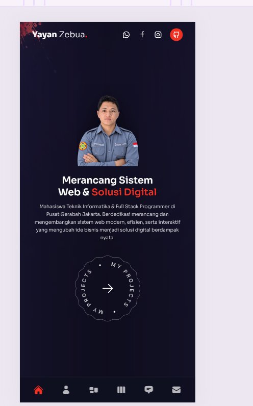
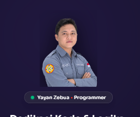
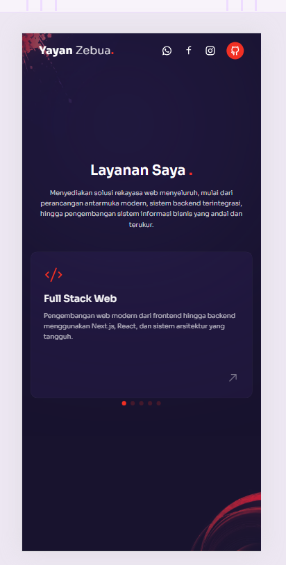

<div align="center">

  

  <br />
  <br />

  <h1>YAYAN ZEBUA</h1>
  <p><strong>Personal Portfolio Website</strong></p>
  <p><em>Engineering Scalable Web Architectures, Interactive Systems & Digital Experiences</em></p>

  <p>
    <a href="https://github.com/yayanzebua/yayan-zebua-portfolio/blob/main/LICENSE">
      
    </a>
    <a href="https://nextjs.org/">
      
    </a>
    <a href="https://react.dev/">
      
    </a>
    <a href="https://www.typescriptlang.org/">
      
    </a>
    <a href="https://tailwindcss.com/">
      
    </a>
    <a href="https://vercel.com/">
      
    </a>
  </p>

</div>

---

## Table of Contents

- [Overview](#overview)
- [Features](#features)
- [Screenshots](#screenshots)
- [Tech Stack](#tech-stack)
- [Project Structure](#project-structure)
- [Getting Started](#getting-started)
- [Installation](#installation)
- [Environment Variables](#environment-variables)
- [Development](#development)
- [Production Build](#production-build)
- [Deployment](#deployment)
- [Security](#security)
- [License](#license)
- [Contact](#contact)

---

## Overview

Welcome to the official repository of **Yayan Zebua's Personal Portfolio Website**.

Designed with an international digital product standard, this platform represents a synthesis of technical rigor and contemporary user experience. The application functions as an interactive showcase of full-stack web engineering, real-world client implementations, architectural decisions, and software craft.

Developed by **Yayan Zebua**—a Computer Science (Informatics Engineering) student and Full Stack Programmer at Pusat Gerabah Jakarta—this portfolio demonstrates end-to-end competencies in modern web systems, ranging from serverless backend architectures and robust API security to fluid GPU-accelerated motion interfaces.

---

## Features

| Feature Domain | Architectural Capability | Description |
| :--- | :--- | :--- |
| **Full-Stack Performance** | Next.js 16 App Router & Turbopack | Sub-millisecond server rendering, intelligent asset streaming, and optimized client hydration. |
| **Adaptive Navigation** | Context-Aware Dual Layout | Responsive bottom tab bar on mobile viewports and floating dock navigation on desktop screens. |
| **Project Showcase** | Swiper Interactive Slider | Dynamic presentation of enterprise systems including POS, ERP, IoT monitoring, and REST API Gateways. |
| **Technical Matrix** | Categorized Skills System | Detailed taxonomy of competencies across Web Programming, Backend Architecture, Databases, and UI/UX. |
| **Secure Contact Gateway** | Serverless Edge Route | Sliding-window IP rate limiting, Google reCAPTCHA v3 validation, CSRF origin verification, and Resend email dispatch. |
| **Motion Engineering** | Framer Motion & tsParticles | 60 FPS hardware-accelerated entrance transitions, reactive particles, and zero-blocking page navigation. |
| **Optimized Media Pipeline** | Next-Gen WebP Conversion | 92%+ transfer size reduction, shimmer skeleton placeholders, and layout-shift (CLS) prevention. |
| **Security Hardening** | Enterprise Security Headers | Comprehensive CSP policy, clickjacking defense (`DENY`), MIME sniffing protection, and strict referrer policy. |

---

## Screenshots

<div align="center">
  <table>
    <tr>
      <td width="33%" align="center">
        
        <br />
        <sub><b>Hero Section (Mobile)</b><br />Transparent Cutout & Interactive CTA</sub>
      </td>
      <td width="33%" align="center">
        
        <br />
        <sub><b>About & Credentials</b><br />Experience, Real Metrics & Skill Hierarchy</sub>
      </td>
      <td width="33%" align="center">
        
        <br />
        <sub><b>Services & Capabilities</b><br />Interactive Service Sliders & Core Competencies</sub>
      </td>
    </tr>
  </table>
</div>

---

## Tech Stack

This project strictly utilizes modern, verified dependencies configured for speed, type safety, and scalability.

### Core & Framework
-  **Next.js 16.4** — React Framework for the Web with App Router and Turbopack.
-  **React 19.3** — Declarative UI component primitives and concurrent rendering.
-  **TypeScript 6.0** — End-to-end static type verification and schema contracts.

### Styling & Motion
-  **Tailwind CSS v4** — High-performance utility-first styling engine.
-  **Framer Motion 14** — Production-ready physics-based animations.
-  **Swiper 14** — Modern touch slider for projects and testimonials.
-  **tsParticles 4** — Lightweight GPU particle visual canvas.

### Backend, Email & Security
-  **Node.js** — Serverless runtime engine.
-  **Resend** — Transactional email delivery infrastructure.
-  **Google reCAPTCHA v3** — Frictionless bot prevention and abuse defense.

### Quality & Deployment
-  **ESLint 9** — Code quality and standards enforcement.
-  **Vercel** — Global Edge Network deployment with automated CI/CD.

---

## Project Structure

```bash
modern-portfolio/
├── app/
│   ├── about/page.tsx             # Interactive About & professional journey
│   ├── api/contact/route.ts       # Secure serverless contact endpoint (Rate-limited, reCAPTCHA, Resend)
│   ├── contact/page.tsx           # Contact form interface with real-time feedback
│   ├── services/page.tsx          # Service offerings & engineering competencies
│   ├── testimonials/page.tsx      # Client reviews & collaborative testimonials
│   ├── work/page.tsx              # Featured systems & full-stack project showcases
│   ├── globals.css                # Tailwind CSS v4 styling & entrance keyframes
│   ├── layout.tsx                 # Root layout with responsive navigation & preconnected typography
│   └── page.tsx                   # Hero section with interactive CTA & cutout portrait
├── components/
│   ├── Avatar.tsx                 # Desktop hero portrait container
│   ├── Bulb.tsx                   # Ambient glowing lighting effect
│   ├── Circles.tsx                # Background circular geometry asset
│   ├── Header.tsx                 # Top brand bar with verified social links
│   ├── Nav.tsx                    # Adaptive dual-mode navigation (mobile bottom dock & desktop dock)
│   ├── ParticlesContainer.tsx     # GPU-accelerated idle-mounted particle canvas
│   ├── ProjectsBtn.tsx            # Animated circular project badge CTA
│   ├── ServiceSlider.tsx          # Swiper carousel for engineering services
│   ├── Skeleton.tsx               # Skeleton loading placeholder components
│   ├── SkeletonImage.tsx          # Progressive image loader with skeleton shimmer
│   ├── Socials.tsx                # Verified social media channels
│   ├── TestimonialSlider.tsx      # Client testimonial Swiper slider
│   ├── TopLeftImg.tsx             # High-priority decorative explosion asset
│   └── WorkSlider.tsx             # Interactive project showcase slider
├── docs/
│   └── images/                    # Verified screenshots & original SVG vector banner
├── lib/
│   └── contact.ts                 # Form validation schemas & reCAPTCHA helpers
├── public/                        # Compressed WebP assets & vector icons
├── .env.example                   # Template for environment configuration
├── next.config.ts                 # Hardened CSP, compression, and Next.js 16 settings
├── package.json                   # Project dependencies and script declarations
├── tsconfig.json                  # Strict TypeScript compiler options
└── variants.ts                    # Framer Motion animation configurations
```

---

## Getting Started

### Prerequisites
Before running the application locally, ensure you have the following installed on your machine:

- **Node.js**: `v18.18.0` or higher (Node.js `v20+` recommended)
- **Package Manager**: `npm` (v9+) or `pnpm`
- **Git**: Installed and configured

Verify your environment:
```bash
node -v
npm -v
git --version
```

---

## Installation

1. **Clone the repository:**
   ```bash
   git clone https://github.com/yayanzebua/yayan-zebua-portfolio.git
   cd yayan-zebua-portfolio
   ```

2. **Install project dependencies:**
   ```bash
   npm install
   ```

3. **Configure Environment Variables:**
   ```bash
   cp .env.example .env.local
   ```
   Open `.env.local` and populate the required API credentials.

---

## Environment Variables

The project uses environment variables to safely configure third-party services. Store your real secrets in `.env.local` (which is strictly ignored by Git).

| Variable Name | Required | Description | Example / Fallback |
| :--- | :---: | :--- | :--- |
| `NEXT_TELEMETRY_DISABLED` | Optional | Disables Next.js telemetry collection | `1` |
| `RESEND_API_KEY` | Required | API key from Resend dashboard | `re_xxxxxxxxxxxxxxxxxxxxxxxx` |
| `RESEND_FROM_EMAIL` | Required | Verified sender address in Resend | `Yayan Zebua <onboarding@resend.dev>` |
| `CONTACT_TO_EMAIL` | Required | Destination address for contact submissions | `yayanzebua15@gmail.com` |
| `NEXT_PUBLIC_RECAPTCHA_SITE_KEY` | Required | Public site key for Google reCAPTCHA v3 | `6Lxxxxxxxxxxxxxxxxxxxxxxxxxxxxxxxx` |
| `RECAPTCHA_SECRET_KEY` | Required | Secret verification key for Google reCAPTCHA | `6Lxxxxxxxxxxxxxxxxxxxxxxxxxxxxxxxx` |
| `RECAPTCHA_MIN_SCORE` | Optional | Minimum bot risk threshold (0.0 to 1.0) | `0.5` |

---

## Development

To start the local development server with Turbopack acceleration:

```bash
npm run dev
```

The application will be accessible at:
```
http://localhost:3000
```

- **Turbopack:** Enables instant Hot Module Replacement (HMR).
- **Idle Mounting:** Particle engines mount during idle cycles to ensure instantaneous first interaction.

---

## Production Build

To test and produce an optimized production-grade bundle:

```bash
# 1. Type-check and create production build
npm run build

# 2. Start production server locally
npm run start
```

To run the ESLint static code analyzer:
```bash
npm run lint
```

---

## Deployment

The application is natively optimized for deployment on **[Vercel](https://vercel.com)**.

### Step-by-Step Vercel Deployment

1. **Push your code to GitHub:**
   Ensure your repository is hosted at `https://github.com/yayanzebua/yayan-zebua-portfolio`.

2. **Import into Vercel:**
   - Log in to [Vercel](https://vercel.com/) with your GitHub account.
   - Click **"Add New Project"** and select **`yayan-zebua-portfolio`**.

3. **Configure Build Settings:**
   - Framework Preset: **Next.js** (automatically detected).
   - Root Directory: `./` (leave default).

4. **Add Environment Variables:**
   Under the **Environment Variables** tab, copy the values from your `.env.local`:
   - `RESEND_API_KEY`
   - `RESEND_FROM_EMAIL`
   - `CONTACT_TO_EMAIL`
   - `NEXT_PUBLIC_RECAPTCHA_SITE_KEY`
   - `RECAPTCHA_SECRET_KEY`
   - `RECAPTCHA_MIN_SCORE`

5. **Deploy:**
   - Click **Deploy**. Your portfolio will be live in under 45 seconds with global Edge CDN caching and automated SSL HTTPS.

### References
- [Next.js Deployment Documentation](https://nextjs.org/docs/app/building-your-application/deploying)
- [Vercel Git Integration Documentation](https://vercel.com/docs/deployments/git)

---

## Security

This repository implements multi-layered security controls to protect visitor privacy, prevent server resource exhaustion, and eliminate common web vulnerabilities:

1. **Content Security Policy (CSP):**
   Strict directive set in [`next.config.ts`](next.config.ts) restricting script execution, style sources, fonts, and blocking unauthorized iframes (`frame-ancestors 'none'`).
2. **Defensive HTTP Headers:**
   - `X-Frame-Options: DENY` (Anti-clickjacking protection).
   - `X-Content-Type-Options: nosniff` (MIME-sniffing protection).
   - `Referrer-Policy: strict-origin-when-cross-origin`.
   - `Permissions-Policy` disabling camera, microphone, and geolocation.
3. **Sliding-Window IP Rate Limiter:**
   In-memory rate limiting on `/api/contact` enforcing a strict maximum of **5 submissions per 10-minute window** per client IP.
4. **Cross-Site Request Forgery (CSRF) Defense:**
   Strict verification of `Origin` and `Host` headers on mutation endpoints.
5. **Stored XSS Prevention:**
   Deterministic HTML entity encoding (`escapeHtml`) on all user-submitted form fields prior to any storage or forwarding.
6. **Payload Size Guard:**
   Rejection of incoming HTTP request payloads larger than **10 KB** (`413 Payload Too Large`).
7. **Resource Exhaustion Guard:**
   Enforced upper bound of 100 entries on local message caches to guarantee zero disk saturation.
8. **Credential Hygiene:**
   Zero-commit policy on sensitive credentials enforced via comprehensive [`.gitignore`](.gitignore).

---

## License

This project is licensed under the **MIT License**.  
See the [`LICENSE`](LICENSE) file for complete terms and copyright details.

```text
Copyright (c) 2026 Yayan Zebua
```

---

## Contact

Feel free to connect for software engineering inquiries, enterprise solutions, or technical collaboration:

<div align="center">

| Channel | Contact Reference | Link |
| :--- | :--- | :--- |
| **Developer** | Yayan Zebua | [yayan-zebua-portfolio](https://github.com/yayanzebua/yayan-zebua-portfolio) |
| **Email** | `yayanzebua15@gmail.com` | [Send Email](mailto:yayanzebua15@gmail.com) |
| **GitHub** | `@yayanzebua` | [github.com/yayanzebua](https://github.com/yayanzebua) |
| **WhatsApp** | `+62 852-6230-4452` | [Direct WhatsApp Chat](https://api.whatsapp.com/send/?phone=6285262304452) |
| **Instagram** | `@yayanzheb` | [instagram.com/yayanzheb](https://www.instagram.com/yayanzheb/) |
| **Facebook** | `yayanzebua` | [facebook.com/yayanzebua](https://www.facebook.com/yayanzebua) |

<br />

<sub>Designed and engineered with care by <b>Yayan Zebua</b>. Built with Next.js 16 and React 19.</sub>

</div>
